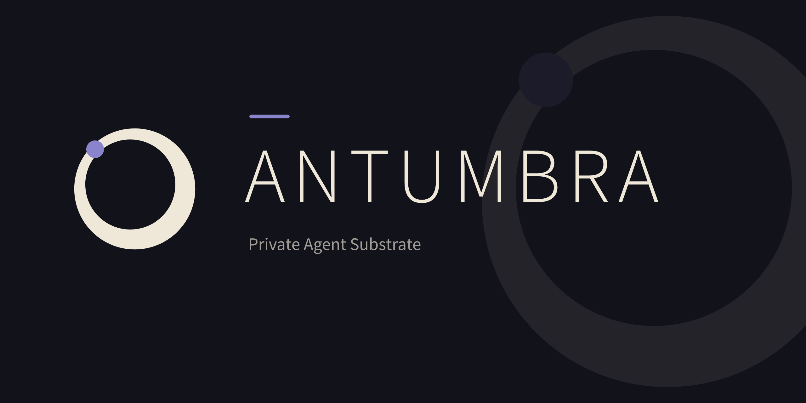

<p align="center">
  
</p>

Antumbra is a private memory and specialist substrate for the coding agent you already use. It plugs into Claude Code, Gemini CLI, Codex, GitHub Copilot CLI, goose and OpenCode over MCP, gives them one memory that carries across sessions, agents and machines, and trains the rules you teach it into small experts that it serves on your own hardware. Your agent stays the hands. Antumbra is what it knows about your work, and it runs where you run it.

---

## What it does

- **A session opens knowing your work.** A hook puts your standing conventions and the memories relevant to the project into the agent's opening context, another recalls for each prompt, and a third asks for what a turn learned when it ends. One memory serves every agent you connect, on every machine.
- **A memory about code says where it was learned.** It carries the repository, commit and branch. Recall scopes to where you are, and a memory whose commit is not on your branch, or whose branch is gone, is marked so. A GitHub App keeps those anchors right as branches merge and are deleted.
- **The system keeps its memories itself.** It counts what recall shows, judges at the end of each turn which of those the answer drew on, links a new memory to what it restates, and lets an unused one fade. Nobody has to curate.
- **Rules become experts.** A behavior is how you want an agent to act on a class of tasks, recorded with a check a program can run. The behaviors you accept are what your own expert is trained on: a [LoRA adapter](https://huggingface.co/docs/peft/en/developer_guides/lora) over a shared base model, admitted when it follows them better than the base does on examples held out of its training, and frozen once admitted.
- **It serves them on the hardware you have.** A GPU, or a CPU through Antumbra's own kernels (AVX-512, AVX2 and NEON), with the requests waiting on a server answered together.
- **Sharing is deliberate.** Memory lives in compartments you own and grant, tenancy is enforced in the database engine, and a store on a laptop syncs with one a team shares.
- **You can see it.** A web dashboard, an operator console in the terminal, and relics: the pages an agent writes for you, kept where you can find them again.

## Quick start

Install the CLI from a release. The command names a tag rather than `latest`, so what it runs is a published, unchanging asset, and the installer checks the archive against the sha256 built into it.

```bash
# macOS / Linux
curl --proto '=https' --tlsv1.2 -LsSf https://github.com/albedosehen/antumbra/releases/download/v0.5.1/antumbra-cli-installer.sh | sh
```

```powershell
# Windows (PowerShell)
irm https://github.com/albedosehen/antumbra/releases/download/v0.5.1/antumbra-cli-installer.ps1 | iex
```

Then, with Docker and ollama running:

```bash
antumbra setup local     # the store and the server on this machine
antumbra setup check     # every piece, and what to do about any that is not right
```

`setup local` starts SurrealDB and the Antumbra server in Docker, pulls the embedding model, generates the stack's secrets, mints a token, and connects Claude Code and every other supported agent it finds on the machine. No clone is needed: outside one it writes the stack's compose file to `~/.antumbra/stack/docker` and pulls the server image published for its version (`ghcr.io/albedosehen/antumbra-mcp`, for x86-64 and ARM). Inside a clone it builds the server from the source.

For a workspace someone else runs, there is nothing to start:

```bash
antumbra setup hosted https://their-workspace.example --token-file <file>     # or --signin-link '<link>'
```

Start a new session in your agent. It opens with what Antumbra remembers, and what you work on goes back in.

**[Getting started](docs/getting-started.md)** walks through this and through each step by hand, on macOS, Windows and Linux. An agent setting it up for someone follows **[docs/agent-setup.md](docs/agent-setup.md)**. To look around with nothing set up, `antumbra tui --demo` shows the console over a seeded population.

## The agents it connects

| Agent | What `antumbra setup` writes |
| --- | --- |
| Claude Code | hooks and `env` in its `settings.json`, and the MCP server |
| Gemini CLI | an extension: the MCP bridge and three hooks |
| Codex | the MCP bridge with `codex mcp add`, and three hooks you approve in Codex |
| GitHub Copilot CLI | a hooks file, and the MCP bridge in its `mcp-config.json` |
| goose | a plugin: the MCP bridge and three hooks, and the file goose keeps in mind |
| OpenCode, 1.x and 2.x | one plugin file |

Setup connects every one of these it finds on the machine, and `--agent` names them instead. Each was run against the real tool. Where an agent reads a directory of Antumbra's own, that is all setup writes; where it reads only your files, setup adds to them with a backup and never twice. What it writes for each, and what each agent leaves to you, is in **[Using Antumbra](docs/integration.md#agents-other-than-claude-code)**.

- **Any other MCP client** reaches the tools through `antumbra mcp bridge`, the server's endpoint as a command, with the token read from its file for each call and never written into the client's config.
- **Agents started through Unity Gateway** (Databricks' `ug claude`, `ug gemini`, `ug opencode`) are followed too. Where `ug` moves an agent's config directory, setup writes there as well, and `antumbra setup check` says when a workspace's policy stops the hooks or the server. This follows `ug`'s source and was not run against a workspace: [how](docs/integration.md#agents-started-through-unity-gateway).
- **Claude Code with its telemetry off** also loses features that have nothing to do with telemetry, with nothing said. `antumbra claude doctor` lists what is lost and what brings each back: [how](docs/integration.md#claude-code-with-its-telemetry-off).

## How it learns

Most assistants are one large model in someone else's data center, exactly as good tomorrow as today. Antumbra keeps a population of small, frozen specialists over one shared, code-capable base (Qwen2.5-Coder-1.5B-Instruct), and grows it from what is verified in your own work.

- **From outcomes, not imitation.** What is trained on is what a check accepts: a behavior's own test of an answer, a test that passes, a command that runs. A critic may say why something failed; the reward is the verifier's.
- **Frozen once admitted.** An admitted expert is never edited, which is the one hard guarantee that a learned skill is not lost when something new is trained. It can be retired, and revived.
- **Scope, not only skill.** A rule is right in one context and wrong in the next: "use `deno install`, not `npm install`" is true in this repository, not everywhere. Experts are kept per scope, a boundary records where a behavior stopped holding, and the router sends a task to an expert that covers it or declines.
- **The memory is the portable part.** An expert is an overlay on one base. Move to a stronger base and your experts are trained again from the behaviors and memories you already have.

There are two kinds of expert today. **Standing experts** are trained from your accepted behaviors by the server itself, with no command to run, and are part of every answer in their scope. An expert is admitted holding the behaviors it learned, and refused when it answers one worse than the base model or when unrelated tasks fall. **Routed experts** come from the trainer (`antumbra train`: RAFT and GRPO over verified completions) and are chosen for a task by a learned router. **[Running the trainer](docs/running-the-trainer.md)** covers both, and **[Antumbra, explained for anyone](docs/antumbra-explained.md)** is the tour without the vocabulary.

## Serving

A server built with the `models` feature answers through the experts (the `answer` tool, `antumbra serve`, `antumbra ask`). With a CUDA GPU it serves the dense base from the GPU. With none, and on a Mac, it serves a quantized base from the CPU through kernels of its own, Q6_K unless told otherwise:

- x86-64 with AVX-512 VNNI, x86-64 with AVX2, and aarch64 with NEON each decode through them. A CPU with AVX2 writes the answer a CPU with AVX-512 writes, token for token, and a Windows build writes the answer a Linux build writes.
- Requests waiting on the server are answered in shared passes, each with its own blend of experts and each as it would be answered alone. Workspaces take turns, and a request past the server's bound is refused as busy.
- A pass also carries the tokens guessed to follow and keeps each that is the model's own, so a prompt like one answered before is answered sooner, with the same answer. A CUDA GPU reads ahead too, through passes of one width, since that is what its library computes a row the same way in.
- A server with no GPU serves the experts another one trained (`--expert-source`).

Measured with a 1.5B base and one expert. An Apple M4 Pro decodes 136 tokens a second from Q6_K. One 8-core laptop CPU, clocking about half its rating, decoded an expert's 78 held-out tasks at 26.8 tokens a second a token a pass, at 33.6 reading ahead, and at 105.7 when the same tasks were asked again, where llama.cpp (build b12359) decoded the same prompts with the same expert as a LoRA at about 18. A desktop CPU with AVX2 alone (an Intel Core i9-12900KS) decodes 46.5 tokens a second from Q6_K a token a pass and reads a 2,300-token pair of prompts at 582, where llama.cpp on that machine decodes 39.5 and reads them at 406; the 78 tasks it decodes at 71.4 reading ahead, and at 378 asked again. An RTX 3090 Ti decodes the same 78 tasks from the dense base at 107.6 tokens a second a token a pass, at 158.9 reading ahead once it has answered the tasks the expert was taught, and at 1,106 when they are asked again. The conditions, and the figures for requests answered together, are in the [changelog](CHANGELOG.md) and in [Running the trainer](docs/running-the-trainer.md#the-gpu-server-serving--standing-experts).

The prebuilt binaries and the published image are the light build, which does everything but train and serve: see [Builds](#builds).

## What runs where

The same engine runs two ways. **Offline**: an embedded store on your disk and MCP over stdio, one identity, nothing leaving the machine. **Networked**: an HTTP server in front of SurrealDB, a signed JWT on every request, many tenants. `antumbra setup local` is the networked server on your own machine, bound to this machine alone.

- **Isolation is the engine's.** Tenancy and identity live in SurrealDB, not in handler code: record access binds `(tenant, user)` to `$auth`, and table permissions filter every row, so a filter forgotten in a handler cannot leak. **[Security posture](docs/security.md)** says what holds, what depends on the deployment, and what the operator sets.
- **Compartments** are named, ownable spaces of memory: the unit of organization, deletion and sharing. A grant gives another user `reference` or `link`, and a revocation is a tombstone that fails closed at once and reaches every device.
- **Sync** keeps an embedded store and a remote one in agreement, last write wins by each row's version, with deletions and revocations carried as tombstones (`antumbra sync`, or a server's own `--sync-remote`). A change to a shared compartment is pushed to the sessions that can see it.
- **The embedder is yours.** Any OpenAI-compatible `/embeddings` endpoint, set per workspace; `setup local` uses ollama's `all-minilm`.
- **Documents and what depends on what.** Knowledge documents are chunked and recalled apart from memory, with the original kept in a copal archive when one is configured. A dependency graph, recorded from evidence, answers what a change to a service reaches (`blast_radius`).
- **Handoffs.** A session leaves a note for a session on another of your machines, and each machine is listed with when it was last seen.

| Surface | Where | For |
| --- | --- | --- |
| MCP | `/mcp`, or stdio | agents. 42 tools; `--tools agent` gives a coding session the 21 it needs and keeps operator actions out of its reach |
| Tool calls over REST | `POST /mcp/call` | the hooks, the CLI and scripts |
| Dashboard | `/dashboard` | you: memory, behaviors, experts, dependencies, knowledge, devices, and the workspace's policy |
| Relics | `/relics` | the pages an agent published, with a gallery, a sandboxed viewer and downloads |
| Operator console | `antumbra tui` | the population, the gate, the loop, memory and the workspace's knobs |
| GitHub App | `POST /github/webhook` | anchors re-anchored at a merge, orphaned at a deleted branch |

The Compose stack is in [`docker/`](docker/README.md): SurrealDB and the server by default, and opt-in profiles for a reranker, a copal archive, an OpenTelemetry collector, a PDF renderer for relics, and the hosted control plane.

## Builds

| Build | How | Adds |
| --- | --- | --- |
| Light | the installers above, the published image, `just install` | memory, recall, documents, routing, sync, the dashboard and the console |
| `models` | `cargo build --release -p antumbra-mcp -p antumbra-cli --features models` | serving on the CPU, the in-process embedder, the trainer's commands |
| `models,cuda` | the same with `--features models,cuda`, or `antumbra setup local --gpu` from a clone | training and serving on an NVIDIA GPU |
| `models,metal` | the same with `--features models,metal` | training on Apple silicon's GPU; it serves from the CPU, which decodes faster there |

- **Platforms.** Prebuilt for macOS on Apple silicon and Intel, Linux on x86-64 and ARM, and Windows on x86-64. x86-64 builds need a CPU with AVX2, FMA and F16C: Intel's since Haswell, AMD's since Excavator.
- **The server alone** installs like the CLI, with `antumbra-mcp` in place of `antumbra-cli` in the installer's address. `setup local` runs it in Docker, so most people never install it by hand. Windows `.msi` packages, per-OS archives and a `.sha256` beside each are attached to every [release](https://github.com/albedosehen/antumbra/releases), and [Getting started](docs/getting-started.md) shows how to verify an archive before anything runs.
- **From source** takes the Rust toolchain (1.95 or later): `just install`, or `cargo install --path crates/antumbra-cli --locked` and the same for `crates/antumbra-mcp`. The first run of a `models` build downloads the base model, about 3 GB.

## The CLI

One command, `antumbra`. The ones most people meet:

```bash
antumbra setup local          # or: setup hosted <url>, setup check
antumbra tui                  # the operator console (--demo needs no server)
antumbra claude doctor        # Claude Code with its telemetry off: what is lost, what restores it

# Keep what a framework's own lister prints, anchored to the commit it ran at,
# and derive ownership, hotspots and co-change from git log. No parser to maintain.
antumbra --embedder-url <url> ingest --tenant ws:me --user user:me --title routes -- deno task routes
antumbra --embedder-url <url> git-facts --tenant ws:me --user user:me --compartment comp:repo --days 90

# Keep this store and a remote one in agreement.
antumbra sync --remote ws://host:8000/rpc --remote-user root --remote-pass <pw>
```

And the rest, by what they are for:

- **The store and the population:** `migrate`, `schema`, `status`, `experts`, `route`, `seed`, `remember`, `propose-compartments`, `retire`, `revive`, `revoke-token`, `set-embedder`, `get-embedder`, `reembed`.
- **Agents:** `hook` (answers another agent's hook in that agent's own shape) and `mcp bridge`.
- **Training and serving,** with `--features models`: `train`, `teach`, `eval`, `behave`, `evolve`, `populate`, `consolidate`, `metabolize`, `memory-import`, `scope`, `gate-train`, `gate-sweep`, `gate-outcomes`, `compose`, `ask`, `serve`.
- **Verifiers:** `verifier` (propose a check, measure it against ground truth, and only then let it grant reward) and `critic`.
- **A demo with no model:** `antumbra loop --demo --generations 3`, then `antumbra status`.

A command that embeds needs an embedder: `--embedder-url` naming an `/embeddings` endpoint (ollama serving `all-minilm` is one), or a `models` build's own. With neither it refuses to run rather than fall back to a stand-in, which `--fake-embedder` asks for by name, for a demo.

## Where it stands

- **In daily use:** the memory loop across the six agents, anchors and the GitHub App, handoffs and devices, documents, the dashboard, relics, the console, sync, and tenancy enforced by the engine over a networked SurrealDB.
- **Working, in a `models` build:** standing experts trained from accepted behaviors and audited on examples they never saw, and serving on a GPU or a CPU. Training takes a GPU.
- **Experimental:** routed experts and the learned router, the generational loop that grows a population by itself (`evolve`, `populate`), and the verifier namespace.
- **Not there yet:** many experts over large corpora, which is the real test of generalization and forgetting; a learned latent mixer in place of the coverage gate; composing experts by learned bridges. The hosted control plane has invite-gated signup, magic-link login and token issuance, and no OAuth providers. The dashboard cannot mint a token or manage members.

What changed in each release, with what was measured and what was not run, is in the [changelog](CHANGELOG.md).

## Documentation

- **[Getting started](docs/getting-started.md)**: setup on macOS, Windows and Linux, the quick way and by hand.
- **[Setting up Antumbra: a guide for coding agents](docs/agent-setup.md)**: for an agent doing the setup on someone's behalf, with what setup changes and how to undo it.
- **[Antumbra, explained for anyone](docs/antumbra-explained.md)**: a plain-English tour, no ML background needed.
- **[Using Antumbra](docs/integration.md)**: the three touchpoints, each agent, Unity Gateway, anchors and the GitHub App, the dashboard, relics, behaviors, handoffs, the console, documents and copal, the dependency graph.
- **[Running the trainer](docs/running-the-trainer.md)**: training, the CUDA build, the GPU server, standing experts, and serving on a CPU with its measurements.
- **[Architecture](docs/architecture.md)** and the **[diagram atlas](docs/diagrams.md)**: the thesis, the system, the training flow and the schema.
- **[Security posture](docs/security.md)**: the trust model and what an operator must configure.
- **[Glossary](docs/glossary.md)**: the trainer's vocabulary (RAFT, GRPO, LoRA, QLoRA).
- **[The Docker stack](docker/README.md)**, **[the hook scripts](scripts/hooks/README.md)**, **[test coverage](docs/coverage.md)**, **[Contributing](CONTRIBUTING.md)**.

### Crates

A Rust workspace of 22 crates, and the control server as a workspace of its own.

- **Domain and storage:** `antumbra-core` (types, lifecycle state machines, ports) · `antumbra-store` (SurrealDB persistence through surql-rs, schema as code, vector recall) · `antumbra-auth` (the JWT token contract) · `antumbra-sync` (last-write-wins replication between stores).
- **In and out:** `antumbra-embed` (an `/embeddings` client) · `antumbra-rerank` (a cross-encoder `/rerank` client) · `antumbra-copal` (the document-of-record archive client) · `antumbra-ingest` (the one path a knowledge document takes into the store) · `antumbra-github` (the GitHub App: webhook verification and its handlers) · `antumbra-http` (how Antumbra's own binaries call the server).
- **Learning:** `antumbra-train` (the candle Qwen2.5-Coder and LoRA trainer, and the CPU kernels) · `antumbra-serve` (one resident base, many adapters) · `antumbra-critic` (verifier-first reward) · `antumbra-gate` (the coverage gate and router) · `antumbra-boundary` (counterfactual scope search) · `antumbra-loop` (the durable generational loop) · `antumbra-eclipse` (the loop's standing instruments: held-out slices, impossible tasks, re-verification) · `antumbra-bench` (a retrieval-quality benchmark).
- **Surfaces:** `antumbra-mcp` (the MCP server, the dashboard and relics) · `antumbra-cli` (the `antumbra` command) · `antumbra-tui` (the operator console) · `antumbra-control` and `antumbra-control-server` (hosted onboarding: signup, login and token issuance, run apart from the data plane).

## License

Copyright (c) 2026 Shon Thomas.

Antumbra is source-available under the [Elastic License 2.0](LICENSE) (ELv2, SPDX `Elastic-2.0`); Shon Thomas is the licensor. You may use, copy, modify and distribute it, and run it for yourself or inside your own organization, subject to three limitations:

- You may not provide it to third parties as a hosted or managed service that gives them access to any substantial set of its features or functionality.
- You may not move, change, disable or circumvent any license key functionality, or remove functionality it protects.
- You may not alter, remove or obscure the licensor's licensing, copyright or other notices.

Anyone you give a copy to gets these terms with it, and modified copies must say they were modified. ELv2 is not an open source license as the OSI defines one. The [`LICENSE`](LICENSE) file is the license; this summary is not.
